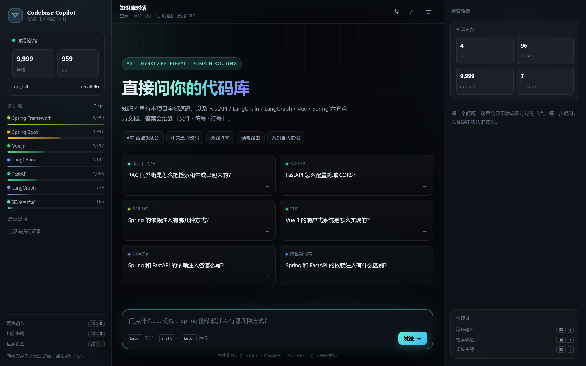
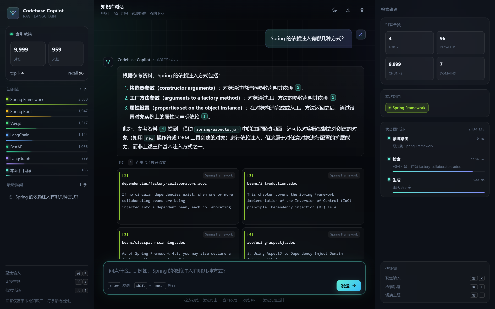
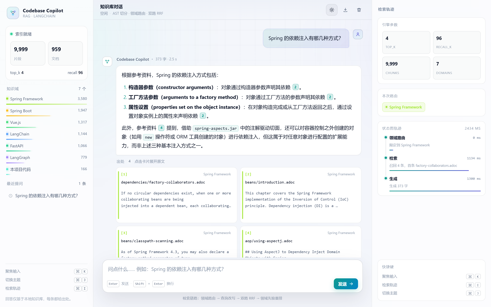
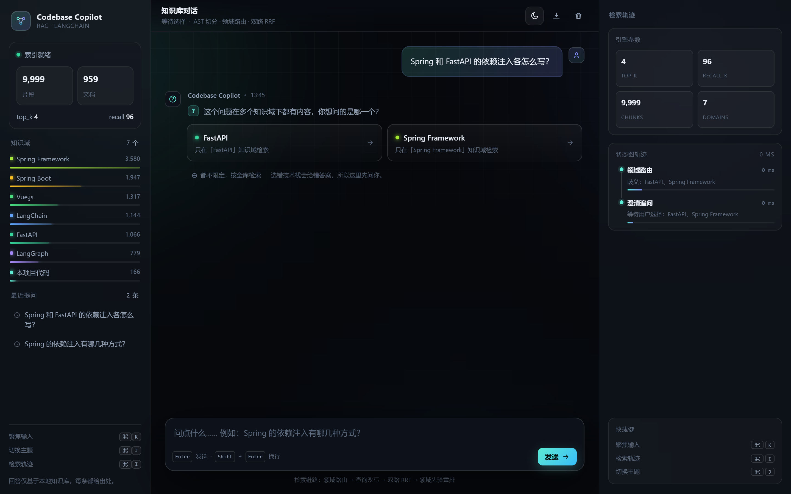

# 代码知识库问答

用 LangChain 搭的**代码 + 框架文档知识库 RAG**：把项目源码和主流框架官方文档灌进向量库，
针对代码或框架提问，回答**精确溯源到文件与行号**。

**七大核心亮点**：

1. **AST 结构化切分**：不是「按字数切文本」的通用 RAG，而是用 AST 按「函数 / 类 / 方法」粒度切分代码，
   每个片段保留签名与精确行号，检索结果是「完整、可定位的代码块」。
2. **跨语言查询改写**：知识库里有大量英文官方文档（FastAPI / Vue / LangChain / LangGraph），
   中文问题会自动翻译成英文检索关键词，用「中文 + 英文」双路检索 + RRF 融合，跨语言命中英文文档。
3. **领域感知检索**：全库近万片段里本项目代码只占 **0.8%**，检索时会被海量官方文档淹没。
   引入「长尾领域先验」（片段越少加权越高，类似 IDF 的思想）纠正这个偏差：
   项目代码域 **92.5%/77.5% → 100%/92.5%**，同时**官方文档域不退化**。
   先验只作用于占比 ≤5% 的长尾领域，不在中等领域之间制造新偏差——
   这个约束是被一次端到端真机验证逼出来的（详见 ADR-011）。
4. **领域路由 + 澄清追问**：知识库横跨 7 个互不相干的技术栈，问「依赖注入怎么用」时，
   检索无法判断你问的是 Spring 还是 FastAPI。项目**不猜，而是认**——
   从问题里识别你提到的框架名（判定准确率 **38/38**），把检索限定在该技术栈内；
   问题同时指向多个技术栈时**不硬答，而是反问**你要问哪一个。
   官方文档域文件级 **87.5% → 95.8%**、MRR +0.056（详见 ADR-013）。
5. **可量化、且被审计过的评测体系**：自建**双域**评测集（项目代码 40 条 + 官方文档 24 条），
   跑「文件级 / 符号级」两级命中率与 MRR，且**评测跑的就是线上真实链路**。
   再往上一层还有**评测口径审计**（`eval_audit.py`）：任何分数变化都要先归因到
   「系统改进」还是「评测口径」。实测真就拆出过一次
   「涨了 12.5pp，其中系统贡献 **0**」的案例（详见 ADR-012）。
6. **案例沉淀（RAG 自我进化）**：贴代码提问后，可一键把「确认有用」的问答沉淀进知识库，
   下次同类问题直接命中——系统会随使用而变强。
7. **交互层与工程化**：链路用 **LangGraph 状态图**编排（`route → clarify → retrieve → generate`），
   每次回答都留下「每步耗时 + 判断」的执行轨迹；同一套能力开放成 **FastAPI 接口**
   （`/ask`、`/ask/stream` SSE 流式）与 **命令行**，三端行为一致；
   另有一个**零依赖单页前端**（无 npm、无构建），流式打字、出处卡片、引用跳转、
   检索轨迹时间线、深浅主题都在里面（`web/index.html`）；
   还有一个**代码修改 Agent**（tool calling），能定位文件、读实现、改代码、跑测试，
   且**默认只出 diff、不写盘**。详见 ADR-015。

> **重要：项目必须放在纯英文路径下。**
> 本项目的向量库用 FAISS，它的底层是 C++ 的 `fopen`，遇到中文路径会直接报
> `could not open ... No such file or directory`。本机路径已选好 `D:\projects\langchain-rag`，
> 请不要再挪到带中文的目录（比如 `C:\Users\林海亘\...`）。

## 界面

前端是**零依赖单页应用**（`web/index.html`：原生 HTML/CSS/JS，没有 npm、没有构建步骤），
由 FastAPI **同源托管**：跑 `10. 网页界面 web（推荐，含 API）`，服务起来后会**自动开浏览器**到 <http://127.0.0.1:8000>。

| 深色 · 首页 | 深色 · 回答 + 出处 + 检索轨迹 |
|---|---|
|  |  |

| 浅色 · 回答 | 澄清追问 |
|---|---|
|  |  |

- **三栏结构**：左「知识域 / 引擎参数 / 最近提问」、中对话、右「状态图轨迹（每步耗时）」
- **流式回答**：SSE 逐字输出，先出出处、再出正文；可随时停止
- **引用可点**：答案里的 `[1]` 点一下，自动定位并高亮对应出处卡片
- **出处卡片**：领域色条 + 相对路径 + 符号名 + 行号 + 原文摘要，可展开、可复制路径
- **澄清追问**：歧义时给选项卡片，点选后带 `forced_domain` 重放，**不会重复插入一条同样的提问**
- **两个主题**：深浅色跟随系统，也可手动切换（`⌘/Ctrl + J`），选择记在本地
- **会话不掉**：刷新页面自动恢复；可一键导出 Markdown、清空会话
- **快捷键**：`⌘/Ctrl + K` 聚焦输入、`⌘/Ctrl + I` 轨迹面板、`Esc` 关抽屉
- **响应式**：窄屏抽屉化（左栏 / 右栏），移动端首屏不自动聚焦、不顶飞内容
- **零外链**：字体用系统栈、图标全内联 SVG，断网也能正常显示

## 能力一览

- **代码结构化切分**：AST 按函数/类/方法/模块级变量粒度切分，保留签名与行号（`app/code_splitter.py`）
- **表格感知切分**：Markdown / AsciiDoc 表格按行切块时**每块都补上表头**，避免表格行退化成没有语境的「孤儿行」而与邻居行互相混淆（`app/loader.py::_split_table_block`）
- **精确溯源**：答案引用精确到「文件:起始行-结束行 + 符号名」，出处平铺展示
- **跨语言查询改写**：中文问题自动翻译成英文关键词，双路检索 + RRF 融合（`app/query_rewriter.py`）
- **框架文档知识库**：内置 FastAPI / LangChain / LangGraph / Vue / Spring Framework / Spring Boot 官方文档（`fetch_docs.py` 一键抓取，支持 Markdown 与 AsciiDoc 两种格式）
- **案例沉淀（RAG 自我进化）**：把「确认有用」的问答写回知识库，增量索引即时生效，且与官方文档隔离并打 `origin=user-case` 标记（`app/case_store.py`）
- **混合检索（可选）**：向量 + BM25 + RRF 融合（`app/hybrid_retriever.py`），有评测数据佐证
- **领域感知检索**：领域识别 + 领域规模先验重排，解决「0.8% 的小领域被 99.2% 的大领域淹没」的问题（`app/domain.py`、`app/retrieval.py`）
- **领域路由 + 澄清追问**：从问题里认框架名（FastAPI / Spring / Vue …）并把检索限定到该技术栈，跨框架概念不再互相干扰；线索指向多个技术栈时返回候选让用户点选，不猜（`app/domain_router.py`）。**比较类问题（「A 和 B 有什么区别」）既不追问、也不收窄，而是按域配额各取几条** —— 它的答案天然需要两边资料，只给一边等于把问题变不可答（实测：全局 top-4 曾全被 FastAPI 占满）
- **LangGraph 状态图**：`route → clarify → retrieve → generate` 显式建图，带条件边与中断，每次执行留 `trace`（每步耗时与判断），可回答「到底是路由错了还是检索没召回」（`app/graph.py`）
- **HTTP 接口**：`POST /ask`、`POST /ask/stream`（SSE）、`GET /health`、`GET /stats`、`POST /cases`，打开 `/docs` 即可在线试（`app/api.py`）
- **Web 前端（零依赖单页）**：原生 HTML/CSS/JS，无 npm 与构建链；SSE 流式、引用跳转、出处卡片、检索轨迹、会话恢复、Markdown 导出、深浅主题、响应式抽屉（`web/index.html`，由 `app/api.py` 同源托管）
- **代码修改 Agent**：5 个工具（`list_files` / `grep` / `read_file` / `propose_edit` / `run_tests`），两阶段写盘、路径锁定在项目内、禁写 `.env`/`storage`/`data`、不开放任意命令执行（`app/code_agent.py`）
- **数据卫生 + 索引体检**：空壳页（只剩 frontmatter）与导语页（整页只预告下一节）都不入库；`prune_index.py` 能**不重建索引**就把脏片段摘掉（零 embedding 调用）
- **评测体系**：`eval_retrieval.py` 跑**双域**评测（项目代码 40 条 + 官方文档 24 条），`eval_domain.py` 做诊断与参数扫描，`eval_rerank.py` 是重排序对照实验（结论：负优化，不引入），`eval_routing.py` 对比领域路由四种策略，`eval_audit.py` 做评测口径归因审计
- **技术决策记录**：`docs/decisions/` 沉淀了 16 条关键取舍（含踩坑、实验与证伪结论）

## 检索效果（可复现）

`python eval_retrieval.py` 的实际输出（`top_k=4`、`recall_k=96`、`alpha=0.02`）：

| 域 | 策略 | 文件级 | 符号级 | 文件 MRR |
|---|---|---:|---:|---:|
| 项目代码域（40 条） | 纯向量（旧口径） | 95.0% | 77.5% | 0.858 |
| | 混合检索（对照） | 90.0% | 72.5% | 0.833 |
| | 重排序 rerank（对照，不采用） | 100.0% | 85.0% | 0.869 † |
| | 领域路由前（基线） | 97.5% | 80.0% | 0.823 † |
| | **线上链路（含领域路由）** | **97.5%** | **80.0%** | **0.838** |
| 官方文档域（24 条） | 纯向量（旧口径） | 79.2% | — | 0.615 |
| | 混合检索（对照） | 62.5% | — | 0.521 |
| | 重排序 rerank（旧口径对照，不采用） | 79.2% | — | 0.618 † |
| | 领域路由前（基线） | 87.5% | — | 0.691 † |
| | **线上链路（含领域路由）** | **95.8%** | — | **0.747** |

> **† 这几行是语料扩充前的历史数据，本次没有重跑**，保留是为了说明对照组结论
> （rerank 与混合检索均为负优化）。
>
> **2026-10-17 重建索引后的一个观察**：代码库从 15 个文件扩到 20 个（补进领域路由、
> 状态图、API、代码 Agent），**命中率完全没变，但项目域文件 MRR 从 0.879 掉到 0.838**。
> 候选池变大，正确答案的排名位次被挤后了一点 —— 这是检索系统扩容后的正常现象。
> 值得记住的是：**只看命中率会漏掉排名质量的变化**，两个指标得一起看。

> 「符号级」= 精确命中到具体的函数 / 类 / 变量，只在项目代码域有意义
> （官方文档没有代码符号，其符号级等同于文件级）。
>
> **关于官方文档域的分数**：从 70.8% 一路涨到 **95.8%**，涨了 25pp，但这 25pp 来自三个
> 完全不同的源，必须分开记账：
>
> ① **口径修正**（70.8% → 83.3%）：原口径被低估了 —— 有 1 条评测项的「标准答案」
>    是一份 96 字节的空文件（`langchain/retrieval.md`，正文一个字都没有），
>    另外 3 条对泛化问题用了过窄的单一答案。**这部分的系统贡献是 0。**
> ② **又一处标注错误**（83.3% → 87.5%）：「Spring 的依赖注入」的标准答案指向了
>    `dependencies.adoc`，而它只是 474 字节的**章节导语页**（正文是「接下来这一节将介绍…」），
>    没有任何 DI 内容。这条评测**从写下第一天就注定失败**，同样与检索算法无关。
>    **系统贡献也是 0。**
> ③ **领域路由**（87.5% → **95.8%**）：这一部分才是真的系统改进。
>
> 把三类来源拆开写，是为了不把「修评测」的功劳算到「修系统」头上。
> 完整归因见 `docs/decisions/adr-012` 与 `adr-013`。
>
> **重排序（rerank）为什么没进主链路**：实测它是一次「此消彼长」——
> 项目代码域符号级 **+5.0pp**（本项目代码的注释是中文，与中文精排模型语言对齐），
> 官方文档域 **-4.1pp**（中文问题配英文文档，精排的跨语言能力不如多语言向量模型）。
> 「双域都不牺牲」是本项目的原则；而且要在项目域单独启用它，得先准确判断问题属于哪个领域
> —— ADR-013 证实语义路由（领域质心）会让项目域文件级从 97.5% 掉到 65.0%，
> 判错就是全盘皆输。对照组在 `eval_rerank.py`。
>
> **关于项目代码域的数字变化**：上一版记录的是 100%/92.5%，现在是 97.5%/80.0%。
> 这不是系统退化，而是**基线变真实**：`data/codebase/` 的源码副本此前靠手工维护，
> 已经过期、且缺少 5 个新模块；`ingest.py` 改为建库前自动同步后，知识库才真正反映当前实现
> （代码片段 45 → 94），片段之间的竞争也随之变激烈。
> 同时长尾先验强度从 `alpha=0.06` 复扫下调到 `0.02`（见 ADR-012 决策三）。

**消融实验**（项目代码域，看清每个机制各自做了什么）：

| 查询改写 | 长尾先验 | 文件级 | 符号级 | 文件 MRR |
|:---:|:---:|---:|---:|---:|
| ✗ | ✗ | 92.5% | 77.5% | 0.833 |
| ✓ | ✗ | 87.5% | 70.0% | 0.677 |
| ✗ | ✓ | 97.5% | 87.5% | 0.902 |
| **✓** | **✓** | **100.0%** | **92.5%** | **0.952** |

> 三个反直觉但有数据支撑的结论：
> ① 查询改写单独用其实是负优化（英文路会稀释中文源码排名）；
> ② 长尾先验单独用是正优化；③ **两者叠加超出各自之和**（先验恰好把被稀释的源码捞回来）。
> 官方文档域的命中率不随这两个开关变化（无路由基线为 87.5%） —— 说明这两个机制是**定向修补长尾偏差**，
> 而不是普遍提升，也说明**为项目域做的优化没有牺牲文档域**。
> 完整推导（含被证伪的「语义路由」方案）见 `docs/decisions/adr-011`。

## 实测性能（可复现）

`python bench_latency.py` —— 8 条覆盖不同领域的问题，本机（DeepSeek 对话 + dashscope 向量）：

| 阶段 | 均值 | P50 | P95 | 最小 | 最大 |
|---|---:|---:|---:|---:|---:|
| 检索（查询改写 + 双路 RRF + 领域先验重排） | 1493 ms | 1359 ms | 2970 ms | 848 ms | 2970 ms |
| 生成（端到端 − 检索） | 2225 ms | 2216 ms | 4162 ms | 1267 ms | 4162 ms |
| **端到端** | **3718 ms** | **3587 ms** | **5186 ms** | 2626 ms | 5186 ms |

**一个反直觉的发现：检索占了端到端的 40%。**

原本以为瓶颈一定在模型吐字，分段测完才发现不是。继续往下拆：

- FAISS 在 10147 个片段上，`k=4` 是 **190ms**、`k=96` 是 **197ms** —— 只差 7ms。
  说明**搜索本身几乎不耗时间**，这 190ms 基本全是「查询向量化」的远程 API 往返。
- 而「检索」这一步里还有**一次查询改写的 LLM 调用**（中文 → 英文关键词，为了跨语言召回）。

所以降延迟的第一优先级是**缓存改写结果**（同一问题重复问、或问题只差几个字时直接复用），
而不是换向量库或调 `top_k`。这条结论只有分段测量才拿得到 —— 只看「3.7 秒」会误判方向。

## 在 PyCharm 里跑（推荐）

**不用碰终端。** 项目已经把 13 个运行配置写进 `.run/` 目录，打开项目后右上角的下拉框里直接就有：

| 下拉框里的名字 | 作用 |
|---|---|
| **1. 建库 ingest** | 把 `data/` 里的文档灌进向量库（改过文档就要重跑一次） |
| **2. 命令行问答 chat_cli** | 控制台里直接打字提问，验证链路最快 |
| **3. 旧版界面 Streamlit（已弃用，别点）** | 早期的极简界面（`localhost:8501`），样式受 Streamlit 限制，**不是正式前端** |
| **4. 测试 pytest** | 跑 38 项离线测试，不需要 API Key |
| **5. 评测 eval_retrieval** | 跑双域检索评测，看命中率与 MRR |
| **6. 领域诊断 eval_domain** | 看知识库领域分布、跨领域干扰诊断与参数扫描 |
| **7. 评测审计 eval_audit** | 拆开「系统改进」与「评测口径」各贡献了多少分 |
| **8. 重排对照 eval_rerank** | 重排序实验（结论：负优化、不引入），可复现证据 |
| **9. 领域路由 eval_routing** | 对比领域路由四种策略，并验证澄清追问的触发行为 |
| **10. 网页界面 web（推荐，含 API）** | **正式界面**：启动后**自动开浏览器**到 `http://127.0.0.1:8000`；`/docs` 是接口文档 |
| **11. 代码 Agent code_agent** | 让它按需求改代码，**默认只出 diff，你确认后才写盘** |
| **12. 索引体检 prune_index** | 报告索引里的空壳页 / 导语页（加 `--apply` 才真删） |
| **13. 性能基准 bench_latency** | 测端到端 / 检索 / 生成的分段延迟，输出 P50 与 P95 |

选好之后点 **绿色三角 ▶** 或按 `Shift+F10` 即可。

第一次打开项目时，PyCharm 会自动认出 `.venv` 作为解释器。
如果下拉框里没看到上面 13 个配置，**关掉项目重新打开一次**（`File → Open` 选 `D:\projects\langchain-rag`）就会出现。

> ⚠️ **「运行后不是这个页面」的三种原因，按顺序排查：**
> 1. **点错了配置**：如果是 Streamlit 那个界面（左边一条灰色侧栏、地址 `localhost:8501`），
>    点的是第 3 个配置。正式前端在第 10 个，地址是 **`8000`**。
> 2. **控制台红字 `ModuleNotFoundError: No module named 'app'`**：这是旧版本直接拿
>    `app/api.py` 当脚本跑留下的坑，**已从两头堵住**——配置改成模块方式（`python -m app.api`），
>    同时 `app/api.py` 顶部加了防呆：**就算你右键 Run 这个文件，也能正常起来**。
>    所以不用管 PyCharm 有没有缓存旧配置，两种点法都能跑。
> 3. **控制台报 `[Errno 10048]` 端口占用**：上一次的服务还开着。任务管理器结束多余的 `python.exe`，或换 `API_PORT`。
>
> 启动成功的标志：控制台打印下面这个方框，并且**浏览器自动弹到前端**
> （端口通了才开页面，不会先甩一个「无法访问」）。
> 服务器 / 无头环境不想弹浏览器，加环境变量 `WBRAG_NO_BROWSER=1`。
> ```
> ==================================================================
>   代码知识库 · Codebase Copilot
>   网页界面   http://127.0.0.1:8000/
> ```
>
> ⚠️ **`app_ui.py` 不要用「右键 → Run 'app_ui'」跑。**
> Streamlit 应用必须通过 `streamlit` 命令启动，直接当 Python 脚本跑会立刻退出、浏览器什么都不显示。
> 现在 `app_ui.py` 顶部已加防呆，误用时它会提示正确命令。

## 如果要用命令行

```bash
# 1. 编辑 .env，填入至少一个 API Key（详见下节）

# 2. 把文档（.txt / .md / .pdf）丢进 data/，然后建库
.venv\Scripts\python.exe ingest.py

# 3a. 命令行问答，快速验证
.venv\Scripts\python.exe chat_cli.py

# 3b. 旧版极简界面（Streamlit，已弃用，仅作对照）
.venv\Scripts\python.exe -m streamlit run app_ui.py

# 3c. 正式 Web 界面（FastAPI 同源托管单页前端，会自动开浏览器）
.venv\Scripts\python.exe -m app.api
# → http://127.0.0.1:8000
```

改完 `data/` 里的文档要**重跑一次** `ingest.py`，否则检索到的还是旧内容。

## 用 Docker 跑（部署用）

仓库带的 `Dockerfile` + `docker-compose.yml` 是给服务器 / 云平台用的。

镜像里**刻意不含**索引和语料（`storage/` 50MB、`data/` 12MB，都在 `.gitignore` 里），
运行时挂载进去 —— 否则每次重建索引都要重新构建镜像。

```bash
# 宿主机上先有索引（没有就建一次）
.venv\Scripts\python.exe ingest.py

# 一条命令起服务
docker compose up --build
# → http://127.0.0.1:8000
```

三个容易踩的点，配置里已经处理：

- **`API_HOST` 必须是 `0.0.0.0`**。`.env` 里写的是 `127.0.0.1`，容器只监听回环的话宿主根本连不上，`docker-compose.yml` 已覆盖。
- **`WBRAG_NO_BROWSER=1`**。容器没有桌面环境，不该去调 `webbrowser`。
- **Key 走 `env_file`**，只在容器环境变量里，不进镜像层（`docker history` 看不到），也不进 git。

部署到 Render / Railway / Hugging Face Spaces 这类平台时，直接把 `Dockerfile` 交给它构建即可。

> ⚠️ **诚实说明：本机没有 Docker，这套配置没实测过。** 只做了路径与变量的一致性检查
> （`API_HOST`、`WBRAG_NO_BROWSER`、挂载点、healthcheck 用的都是代码里真实读的字段）。
> 第一次在装了 Docker 的机器上跑通后，把这条注记删掉再写进简历。

## .env 怎么填

```ini
LLM_PROVIDER=deepseek          # 用哪个模型对话
LLM_MODEL=deepseek-chat
EMBEDDING_PROVIDER=dashscope   # 用哪个模型做向量
EMBEDDING_MODEL=text-embedding-v3

DEEPSEEK_API_KEY=sk-xxx
DASHSCOPE_API_KEY=sk-xxx
```

对话模型和向量模型**分开配置**，因为 DeepSeek 没有 embedding 接口。
四种组合都能用：

| 场景 | LLM_PROVIDER | EMBEDDING_PROVIDER | 说明 |
|---|---|---|---|
| 便宜好用（推荐） | `deepseek` | `dashscope` | 两个 Key 都要 |
| 全 OpenAI | `openai` | `openai` | 一个 Key 搞定 |
| 全本地、零成本 | `ollama` | `ollama` | 需先 `ollama pull qwen2.5:7b` 和 `ollama pull nomic-embed-text` |
| 国产全家桶 | `dashscope` | `dashscope` | 通义千问 + 通义向量 |

## 目录说明

```
langchain-rag/
├── .env                 # 你的 Key，已被 .gitignore 排除
├── .env.example         # 模板，可提交
├── Dockerfile           # 生产镜像（不含索引与语料，运行时挂载）
├── docker-compose.yml   # 一条命令起服务，Key 走 env_file
├── .gitattributes       # 强制 Dockerfile / 脚本用 LF，避免 Windows 换行坑
├── .run/                # PyCharm 运行配置，打开项目即出现在右上角下拉框
├── .streamlit/
│   └── config.toml      # 关掉首次运行的邮箱询问和遥测上报
├── ingest.py            # 第一步：建库
├── chat_cli.py          # 第二步：命令行问答（澄清追问 / 多轮 / 流式）
├── app_ui.py            # 备用：Streamlit 极简界面
├── web/
│   └── index.html       # 正式前端：零依赖单页应用（由 app/api.py 同源托管）
├── code_agent.py        # 第四步：代码修改 Agent 的命令行入口（默认只出 diff）
├── prune_index.py       # 运维：索引体检，摘掉空壳页/导语页片段（不重建索引）
├── eval_retrieval.py    # 评测：双域（项目代码 40 条 + 官方文档 24 条）命中率与 MRR
├── eval_domain.py       # 诊断：领域分布、跨领域干扰、领域先验参数扫描
├── eval_rerank.py       # 对照：重排序（rerank）实验，结论为负优化、不引入
├── eval_audit.py        # 审计：分离「系统改进」与「评测口径」对分数的贡献
├── eval_routing.py      # 对比：领域路由四种策略 + 澄清追问触发行为验证
├── web/
│   └── index.html       # 正式前端：零依赖单页（原生 HTML/CSS/JS，无 npm、无构建）
├── app/
│   ├── config.py        # 全局配置，统一读 .env
│   ├── llm.py           # 模型工厂，对话与向量分开配
│   ├── loader.py        # 文档加载 + 切分（保护代码块与表格、支持 .adoc、空壳/导语页过滤）
│   ├── adoc.py          # AsciiDoc 转纯文本（Spring 官方文档专用）
│   ├── code_splitter.py # AST 代码结构化切分（函数/类/方法粒度）
│   ├── query_rewriter.py # 查询改写：中文问题翻译成英文关键词，跨语言检索
│   ├── domain.py        # 领域识别 + 子库切分 + 长尾领域先验权重
│   ├── domain_router.py # 领域路由 + 澄清追问（从问题里认框架名，而不是猜）
│   ├── retrieval.py     # 检索链路：领域路由 → 查询改写 → 双路 RRF → 领域先验重排
│   ├── graph.py         # 同一链路的 LangGraph 状态图（带条件边、中断与执行轨迹）
│   ├── api.py           # FastAPI 接口 + 前端托管：/、/ask、/ask/stream(SSE)、/health、/stats、/cases
│   ├── code_agent.py    # 代码修改 Agent（tool calling + 路径锁 + 两阶段写盘）
│   ├── case_store.py    # 案例沉淀：把确认有用的问答写回知识库（自我进化）
│   ├── hybrid_retriever.py # 混合检索（向量+BM25+RRF，可选，评测显示负优化）
│   ├── vectorstore.py   # FAISS 建库 / 加载 / 增量追加
│   └── chain.py         # RAG 链，检索 -> 生成 -> 精确溯源
├── fetch_docs.py        # 抓取官方框架文档（FastAPI/LangChain/LangGraph/Vue/Spring）
├── data/                # 放你的文档和代码（含本项目源码 + 6 个框架官方文档）
│   └── cases/           # 用户沉淀的问答案例（界面「记住这个案例」写入）
├── docs/decisions/      # 技术决策记录（ADR），沉淀关键取舍
├── docs/screenshots/    # 界面截图（README 用）
├── docs/test-samples.md # 34 条测试样例（含预期行为与已知失败样例）
├── storage/             # 向量库产物 index.faiss（自动生成，已 gitignore）
└── tests/               # pytest 跑离线冒烟测试，不需要 API Key
```

## 调参

都在 `.env` 里，改完要重跑 `ingest.py`：

- `CHUNK_SIZE` / `CHUNK_OVERLAP`：片段长度。文档碎就调小（500/80），长文调大（1200/200）。
- `TOP_K`：每次检索几段。答不全调大，答偏了调小。

## 常见问题

**第一次启动卡在 `Email:` 等输入** — 这是 Streamlit 的首次运行邮箱询问，不是报错。
按回车（留空）跳过即可。项目里已通过 `.streamlit/config.toml` 关闭该询问，不会再出现。

**`missing ScriptRunContext!` / `Session state does not function`，然后进程直接退出** —
你用 `python app_ui.py` 跑了 Streamlit 应用。Streamlit 必须用 `streamlit run app_ui.py` 启动，
在 PyCharm 里请用第 3 个运行配置。现在 `app_ui.py` 顶部已加防呆，误用时它会直接提示正确命令。

**`向量库不存在：...\storage`** — 还没建库，先跑 `ingest.py`。

**`could not open ... No such file or directory`** — 项目跑到中文路径下了，挪回英文路径。

**回答总说「根据已有资料无法回答」** — ① `data/` 空或没重跑 ingest；② `TOP_K` 太小没检索到关键段落。

**中文问答效果差** — 换成中文向量模型（`dashscope` + `text-embedding-v3`），别用 `text-embedding-3-small` 做中文。

**中文问题问英文文档答不上来** — 项目已内置「查询改写」：中文问题会自动翻译成英文关键词检索。
若想彻底关闭（省一次翻译的 LLM 调用），把 `build_assistant(use_query_rewrite=False)` 即可。

**点了「📌 记住这个案例」没反应或报错** — 沉淀要写 `data/cases/` 并调用一次 embedding，
检查 API Key 余额与 `data/cases/` 是否可写。成功后侧边栏的「已沉淀案例」计数会 +1，且立即可检索。

**响应很慢** — 首次调用在加载模型，属正常。一直慢就把 `TOP_K` 调小。

**新写的模块问不出来** — 知识库是**上一次建库时的快照**。`ingest.py` 建库时会自动把
`app/*.py` 和几个入口脚本同步进 `data/codebase/`，但新增/改动的源码不会自己进库，
重跑一次 `ingest.py` 才会更新（这一步要重新 embedding，几分钟）。

## 下一步可以做什么

已经做完的（原先列在这里的 5 条）：LangGraph 状态图、FastAPI 接口、代码修改 Agent、
导语页/目录页治理、索引零重建清理 —— 见 ADR-014 / ADR-015。

剩下的按优先级：

1. **让「澄清追问」覆盖「一个线索都没有」的问题**（ADR-013 遗留）：当前只在问题
   **显式提到多个框架**时触发；更常见的形态是「依赖注入怎么用」，这类问题走全局检索。
   可选方向是「检索结果跨域分散时给柔性提示」—— 答完再提示，而不是打断，
   但需要先验证它不会变成噪音。
2. **提升改写质量**：官方文档域当前 **95.8%**，残余 1 条（LangChain agent）的根因
   是**改写把正确答案推远了** —— 正确片段在原问题路排第 3、改写路掉到第 95 位。
   可尝试多查询生成，或换多语言能力更强的向量模型。注意 ADR-013 已经证明
   「压低改写路权重」是错的（净负优化），方向该是**提升改写质量**而不是**降低它的权重**。
3. **消除 `chain.py` / `graph.py` 两条链路的技术债**：目前靠「chunk 协议一致」这个
   人为约定在维持，没有自动化的一致性测试兜底。可以补一个「同一问题、两条链路
   返回等价 sources」的测试，或者干脆让 CLI/UI/API 都只走 graph。
4. **代码 Agent 的多文件事务**：改 A 成功、改 B 失败会留半成品（有 diff 可回溯，
   但没有自动回滚）。可改为先写影子目录、全部成功后再整体替换。
5. **明确「用户笔记」的定位**：`data/` 下的学习笔记目前归入 `project` 域、
   享受长尾先验加成，在概念类问题上会压过官方文档。产品上未必是坏事，
   但需要先决定它算不算「正确答案」（见 ADR-012 遗留问题）。

## HTTP 接口怎么用

启动（PyCharm 里选 `10. 接口服务 api`，或命令行 `python -m app.api`），
然后打开 <http://127.0.0.1:8000/docs> 就能在线试所有端点。

```bash
# 普通提问
curl -X POST http://127.0.0.1:8000/ask \
  -H "Content-Type: application/json" \
  -d '{"question": "FastAPI 怎么配置跨域 CORS？"}'

# 歧义时返回 clarification（200，不是 4xx），拿选项后带 forced_domain 重放
curl -X POST http://127.0.0.1:8000/ask \
  -H "Content-Type: application/json" \
  -d '{"question": "Spring 和 FastAPI 的依赖注入各怎么写？"}'
curl -X POST http://127.0.0.1:8000/ask \
  -H "Content-Type: application/json" \
  -d '{"question": "Spring 和 FastAPI 的依赖注入各怎么写？", "forced_domain": "fastapi"}'

# 流式（SSE）
curl -N -X POST http://127.0.0.1:8000/ask/stream \
  -H "Content-Type: application/json" \
  -d '{"question": "Vue 的响应式原理是什么？"}'
```

| 端点 | 用途 |
|---|---|
| `GET /` | 正式前端（单页应用），与 API 同源，无需额外静态服务器 |
| `GET /health` | 探活 + 索引是否就绪（不触发任何模型调用） |
| `GET /stats` | 片段数、文档数、各领域分布 |
| `POST /ask` | 一次性回答，带 `sources` 与 `trace` |
| `POST /ask/stream` | SSE 流式：`clarification` / `sources` / `delta` / `done` |
| `POST /cases` | 把一个问答沉淀进知识库（增量索引，立即生效） |

## 代码 Agent 怎么用

```bash
python code_agent.py                                    # 交互式
python code_agent.py "给 config 的 api_port 补一句注释"   # 一次性
python code_agent.py --yes "..."                        # 跳过确认直接写盘（慎用）
```

默认**只出 diff、不写盘**：跑完会把 unified diff 打给你，输入 `y` 才落盘。
能做的只有五个动作（列文件 / 搜索 / 读文件 / 提交修改 / 跑测试），
写不了 `.env`、`storage/`、`data/`，也没有任意命令执行 —— 边界见 ADR-015。

## 测试样例

想快速验证系统各层是否都还活着，照着 [`docs/test-samples.md`](docs/test-samples.md) 试：

- 34 条问题，分 8 组：冒烟 / 项目代码域 / 官方文档域 / 澄清追问 / 比较类 /
  无线索与边界 / 代码 Agent / **已知会失败的样例**
- 每条都写了「预期看到什么」，可当断言用
- 最后一组是**故意保留的失败样例**（索引未重建、改写质量、库外知识），
  跑它们比跑成功的样例更能说明系统边界在哪
